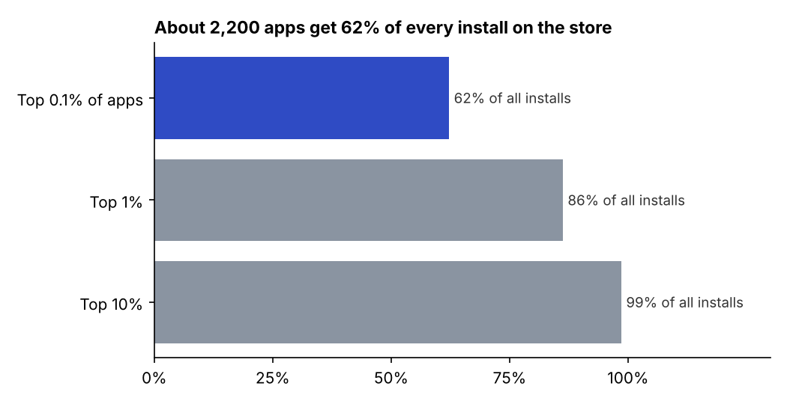
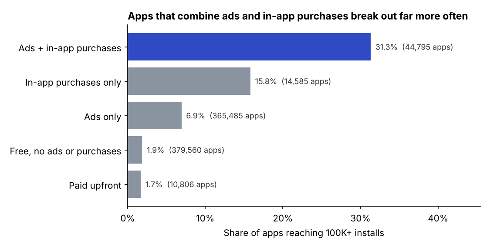
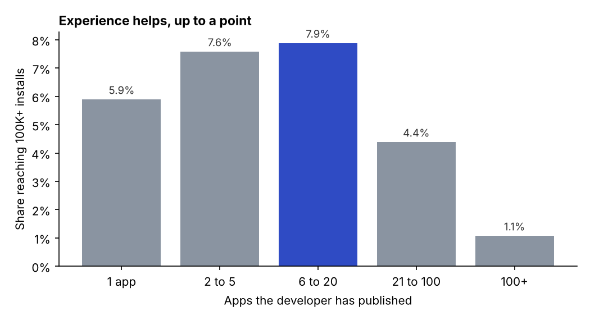
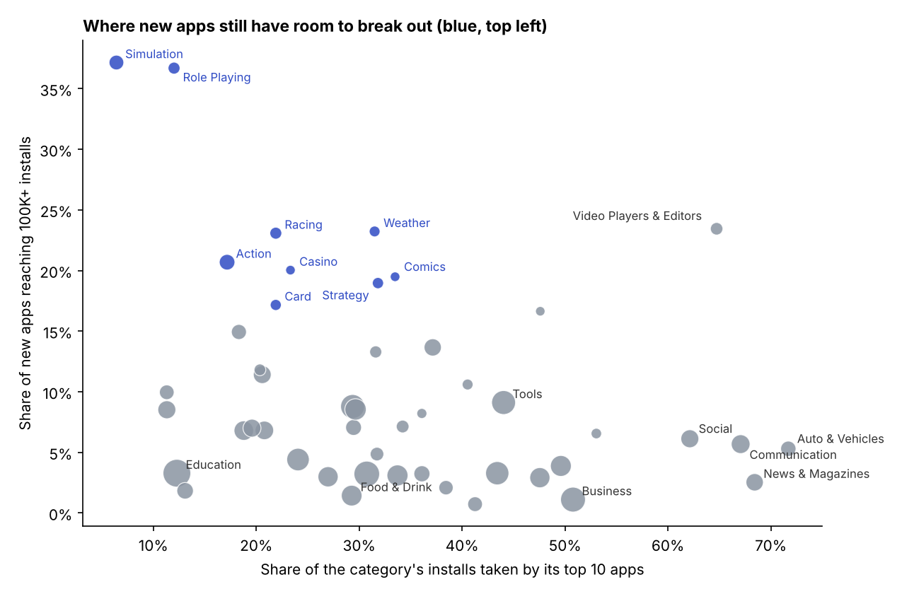
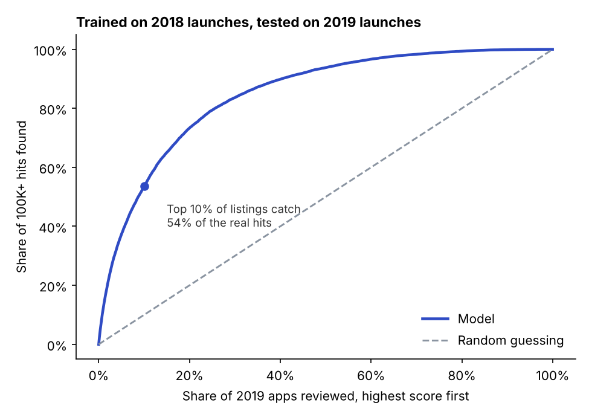

# What actually gets an app to 100K installs?

There are over 2 million apps on Google Play, and most of them go nowhere. I wanted to figure out what the ones that make it have in common, using things you'd actually know when you launch: the category, how you make money, how experienced the developer is.

I used a scrape of 2.24 million Play Store apps from June 2021 and focused on the 815K apps released in 2018 and 2019, since those had at least a year and a half to grow. "Breaking out" here means reaching 100K installs. Only 6% of them did.

**Try it:** [Will your app hit 100K installs?](https://matinnikoo.github.io/simulator.html) is a simulator built from this data. Pick a category, how the app makes money and a few other launch choices, and it estimates the chance of reaching 100K installs and which change would raise it most.

## Summary

- About 2,200 apps get 62% of all installs. The median app has around 700.
- Free apps with both ads and in-app purchases reached 100K 31% of the time. Paid apps, 1.7%.
- Developers with 6 to 20 apps did best (9.8%). Developers with 100+ apps did worst (1.7%).
- In Simulation over a third of new apps broke out. In Social and Communication the top 10 apps take about two thirds of all installs.
- A model trained on 2018 launches and tested on 2019 launches got 0.87 AUC, and its top 10% of picks had 54% of the real hits.

## 1. A few apps get almost everything



The top 0.1% of apps get 62% of every install, the top 1% get 86%, and the top 10% get 99%. More than half of all apps (54%) never reach 1,000 installs. So averages don't really mean much here. What matters is what gets an app into that small group at the top.

## 2. Monetization: ads plus in-app purchases wins



| How the app makes money | Apps | Reached 100K+ |
|---|---:|---:|
| Ads + in-app purchases | 44,795 | 31.3% |
| In-app purchases only | 14,585 | 15.8% |
| Ads only | 365,485 | 6.9% |
| Free, no ads or purchases | 379,560 | 1.9% |
| Paid upfront | 10,806 | 1.7% |

I figured this might just be games, since games use both a lot, but it held up in all 48 categories I checked. It's 34% for games and 28% for everything else.

One catch is that the data shows how apps made money in 2021, not on launch day. Apps that already have users are more likely to add in-app purchases, so part of this is success causing the monetization and not the other way around. Still, charging upfront almost never worked, and apps with no way to make money rarely grew.

## 3. Developer experience has a sweet spot



First time developers broke out 4.6% of the time. That climbs to 9.8% for developers with 6 to 20 apps, probably because they've learned what works. After that it drops, and developers with 100+ apps do the worst of anyone (1.7%). So some experience helps, but just putting out a lot of apps doesn't.

## 4. Where new apps still have room



The x axis shows how much of a category's installs go to its top 10 apps, and the y axis shows how often new apps in it break out. The blue ones in the top left are where new apps break out a lot and nobody dominates.

- Wide open: Simulation (37% breakout, top 10 take only 6%), Role Playing (37%), Racing (23%), Action (21%)
- Locked up: Auto & Vehicles, News & Magazines, Communication and Social, where the top 10 apps take 62% to 72% of installs and new apps break out only 2.5% to 6% of the time
- Hard for consumer apps: Business (1.1%), Food & Drink (1.4%) and Medical (1.8%). These probably need a different plan, like selling to companies directly, rather than counting on downloads

The full table is in [`results/categories.csv`](results/categories.csv).

## 5. Can you spot a future hit from its listing?



I trained a gradient boosting model only on things you'd know at launch: category, content rating, app size, minimum Android version, monetization, whether there's a privacy policy and website, and how many apps the developer has. I left out ratings, reviews and update history on purpose, since those come after installs and would leak the answer.

Instead of a random split, I trained on apps released in 2018 and tested on apps released in 2019. That's closer to how you'd actually use it, predicting new launches from older ones.

- Gradient boosting AUC was 0.87 (a logistic regression baseline got 0.84)
- Only 5.2% of 2019 apps broke out, but the model's top 10% of picks had 54% of them, about 5.4x better than random

It can't pick individual winners, but it would help with something like deciding which new apps to look at first.

## 6. The simulator

I turned the findings into a page anyone can use, so you don't need to read the analysis to get something out of it. It runs entirely in the browser, so I used a logistic regression instead of the gradient boosting model: the whole model is just a list of weights. Trained on 2018 launches and tested on 2019 launches, it scores 0.84 AUC, close to the 0.87 above.

For any setup, the page shows:

- the estimated chance of reaching 100K installs, next to the category average and the average new app
- the changes that would raise it most, like switching how the app makes money or adding a developer website
- how many real apps had the same category and monetization, and how many of them made it

Code is in [`simulator/`](simulator). `build_model.py` trains and exports the model to `model.json`, and `build_page.py` puts it into the page.

## If I were launching an app

1. Don't charge upfront. Launch free and plan to make money with ads and in-app purchases.
2. Pick the category on purpose. Simulation, Role Playing and Racing have room. Social and Communication are mostly owned by a few big apps.
3. Build a few apps, not a hundred.
4. Treat business, food and medical apps differently. They rarely grow through downloads alone.

## Limitations

- Installs are as of June 2021. Apps released in 2019 had less time to grow than 2018 apps, which is part of why I tested on them (it's the harder case).
- Monetization flags reflect the app in 2021, not at launch, so that section shows correlation, not proof of cause.
- "Developer apps" counts everything the developer had on the store in 2021, including apps released later.
- This only covers Google Play, not the App Store.

## Data cleaning

- Started with 2,312,944 rows and ended with 2,241,891 apps
- Dropped apps with no release date or install count and removed duplicate app IDs
- Used `Maximum Installs` (a close to exact count) instead of the bucketed install ranges
- Converted size ("10M", "512k") and minimum Android version ("5.0 and up") to numbers

## Run it yourself

```bash
pip install -r requirements.txt
./get_data.sh          # downloads about 650 MB of data
python analysis.py     # about a minute
python simulator/build_model.py   # rebuilds the simulator's model
python simulator/build_page.py    # rebuilds simulator/index.html
```

It prints every number in this README, saves the charts to `figures/`, and writes all the results to `results/summary.json`.

## Data

[Google Play Store dataset](https://github.com/gauthamp10/Google-Playstore-Dataset) by Gautham Prakash, 2.3M apps scraped in June 2021, MIT license. It's too big to keep in this repo, so `get_data.sh` downloads it.
