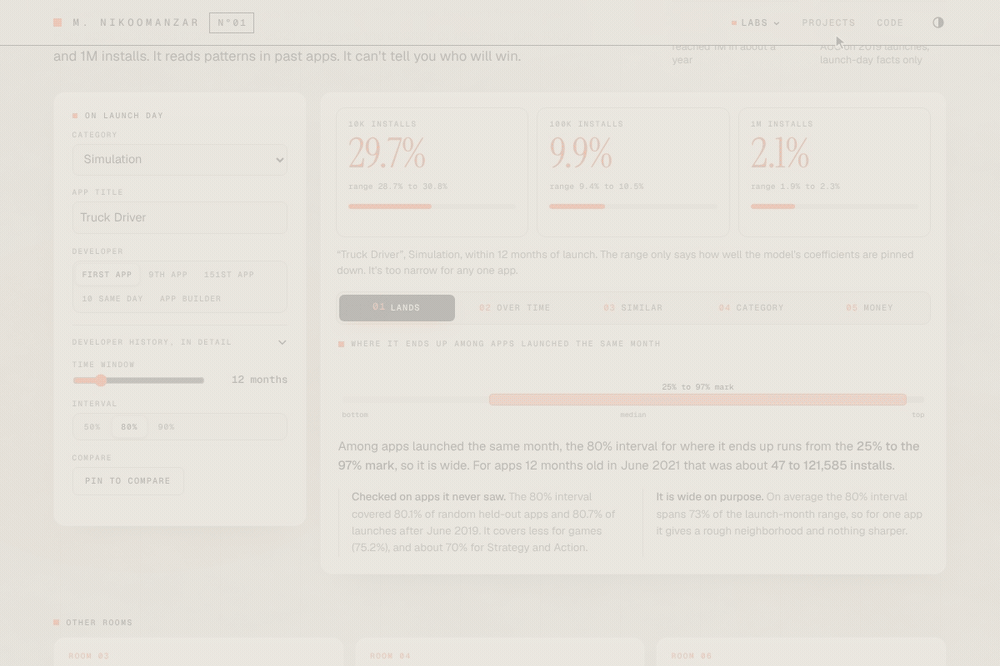
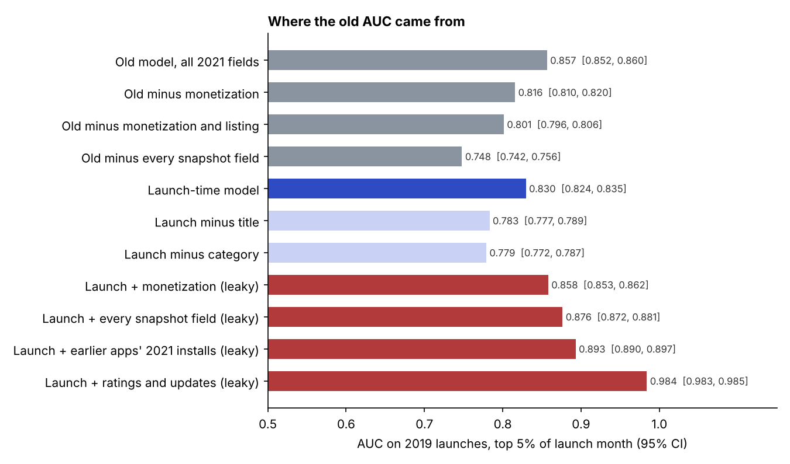
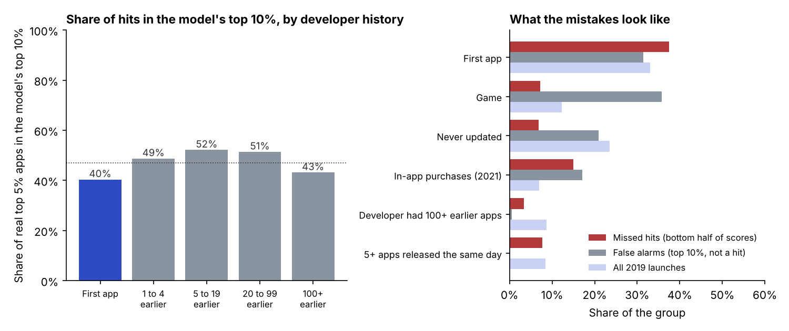
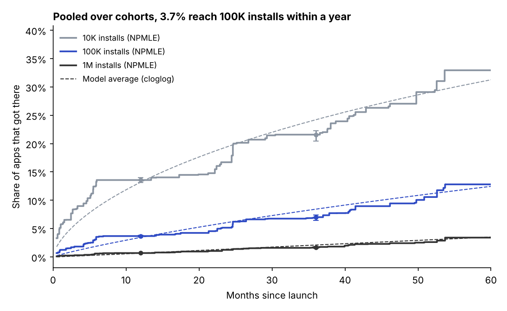
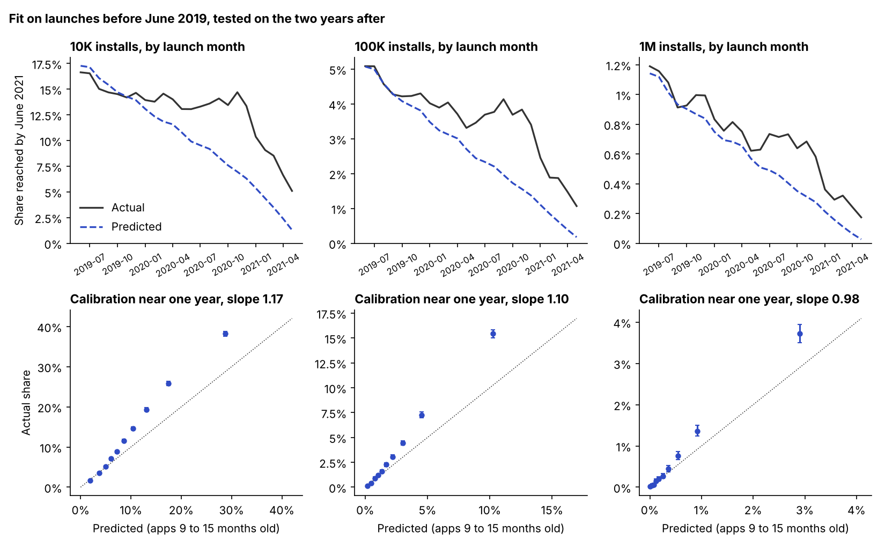
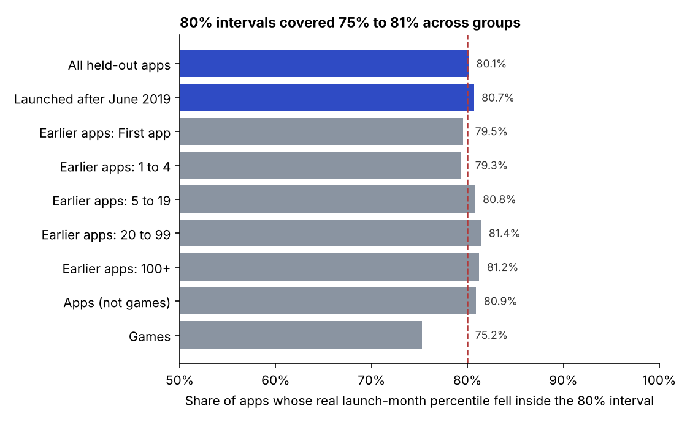
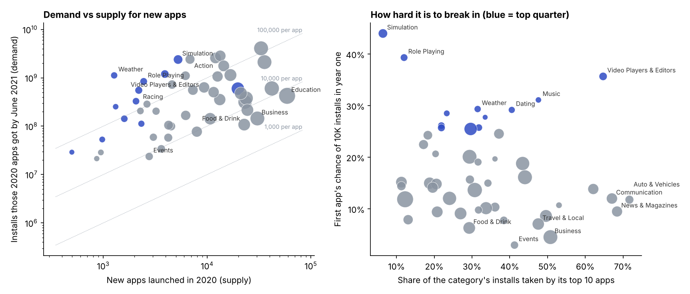
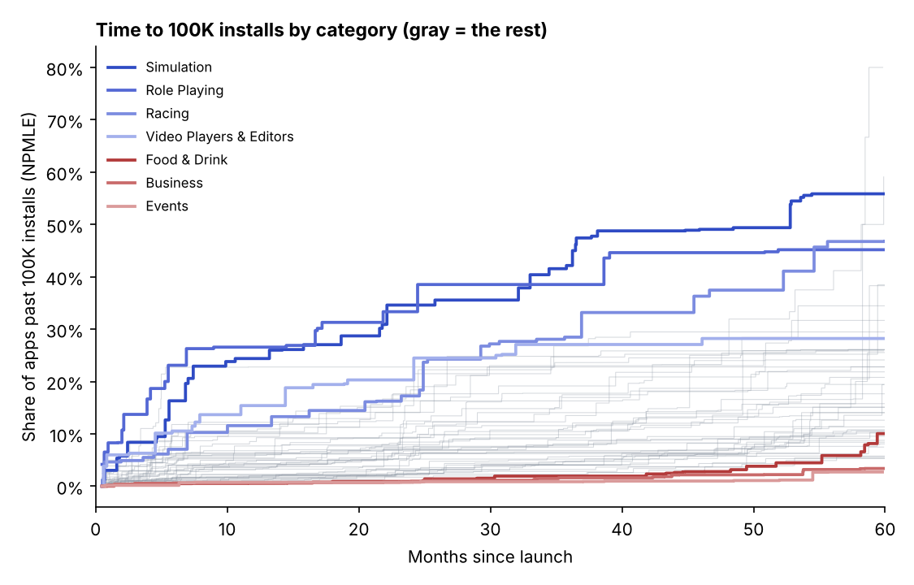
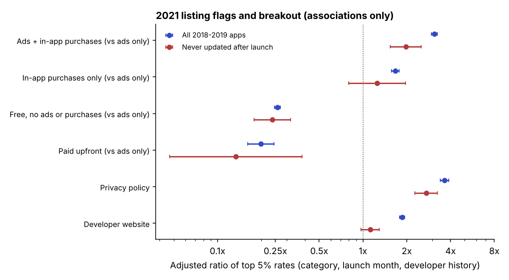
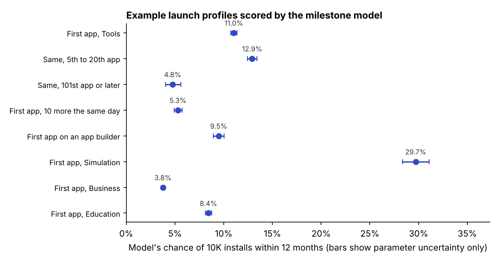

# What can you know on launch day about a Google Play app?

Most new Google Play apps go nowhere. Of the 102,979 apps that were 11 to 13 months old in June 2021 (launched from mid May to mid July 2020), 13.0% had reached 10K installs, 3.5% had reached 100K and 0.6% had reached 1M. I wanted to know how much of that you can see on the day an app launches.



The simulator on my site scoring a made up Puzzle app, then showing real Puzzle apps with a similar launch-day profile.

You can see a fair amount, but not who will win. A model that uses only launch-day facts (category, title and the developer's release history) ranks 2019 launches with an AUC of 0.84. AUC is the chance that a random app that did well is ranked above a random app that did not, so 0.5 is a coin flip and 1.0 is perfect. The model's top 10% of picks holds 47% of the apps that end up in the top 5% of their launch month.

The category moves the odds a lot. The model's average for a developer's first app in Simulation is a 44% chance of 10K installs in its first year. The real first Simulation apps that were 9 to 15 months old got 36%, so the model runs high there. For Business the model says 4.5% and the real rate is 4.5%.

My first version of this project reported an AUC of 0.86. It used monetization, app size, privacy policy and similar fields that were read in June 2021, long after launch, so they partly gave away the answer. The launch-day model scores 0.025 AUC below it (95% CI 0.021 to 0.029). Taking every 2021 field out of the old model drops it from 0.857 to 0.748, which is 30% of its edge over a coin flip, but that comparison is against a weak model. Against the full launch-day model the gap is 7.6% of the old model's edge, because the launch-day features include developer history that the old model lacked. Both numbers come from a 40% sample of the training developers.

To try it, the scorer in this repo gives the chance of 10K, 100K and 1M installs within a year from launch-day inputs.

```bash
pip install .
playodds --category Simulation --name "Truck Driver"
```

It prints the three chances, where the app would land among apps launched the same month, and a few real apps with a similar launch-day profile. There are two kinds of interval in the output. The coefficient range only says how well the model's coefficients are pinned down, and it is too narrow for any one app. The launch-month interval is a conformal interval that was checked on apps the model never saw, and it is wide (section 7).

The same command can also compare two ideas, score a whole CSV of ideas, print the market table for one category and write an HTML report. Those are in [The playodds command](#the-playodds-command).

[What are a new app's odds?](https://matinnikoo.github.io/simulator.html) runs the same launch-day model in the browser through `models/score.js`, so it gives the same numbers as `playodds`, with the intervals and the similar real apps. The older simulator from the first round of this data is still in [`simulator/`](simulator) (more under [The older simulator](#the-older-simulator)).

## The question

Using only what is known on an app's launch day, how well can I rank new apps by how they turn out, and how long do they take to reach 10K, 100K and 1M installs? The question can fail. If launch-day facts carried no information the AUC would be near 0.5 and the old 0.86 would only have come from peeking. They carry a lot, though less than I first reported.

I used a scrape of 2,241,891 Play Store apps from June 2021 (after cleaning, see the bottom). Sections 1 to 4 focus on the 815,231 apps released in 2018 and 2019. The old simulator was trained on 799,763 of them, the ones with a known size and one of the four main content ratings.

## What I found

The first four bullets use the outcome from my first round, which is 100K installs by June 2021 for apps launched in 2018 and 2019. Apps from early 2018 had more than twice as long to grow as apps from late 2019, and sections 5 and 6 deal with that.

- About 2,200 apps get 62% of all installs. The median app has around 700.
- Free apps with both ads and in-app purchases reached 100K 31% of the time. Paid apps, 1.7%. With the fairer outcome of landing in the top 5% of the launch month, it is 28.3% for ads plus in-app purchases and 5.6% for ads only. This is an association and section 9 explains why I wouldn't act on it.
- Developers on their 6th to 20th app did best (7.9%). Developers past their 100th did worst (1.1%).
- In Simulation over a third of new apps broke out. In Social and Communication the top 10 apps take about two thirds of all installs.
- A model on launch-day facts alone gets an AUC of 0.836 on 2019 launches. The same model with the 2021 fields gets 0.861.
- Pooling all launch cohorts, 3.7% of apps reach 100K within 12 months. Cohorts differ, and section 7 shows how much that estimate can be trusted.

## 1. A few apps get almost everything


The top 0.1% of apps get 62% of every install, the top 1% get 86%, and the top 10% get 99%. More than half of all apps (54%) never reach 1,000 installs. So averages say little here, and the rest of this README looks at rates for groups of apps.

## 2. Monetization and breakout


| How the app makes money | Apps | Reached 100K+ by June 2021 | In the top 5% of its launch month |
|---|---:|---:|---:|
| Ads + in-app purchases | 44,795 | 31.3% | 28.3% |
| In-app purchases only | 14,585 | 15.8% | 13.7% |
| Ads only | 365,485 | 6.9% | 5.6% |
| Free, no ads or purchases | 379,560 | 1.9% | 1.4% |
| Paid upfront | 10,806 | 1.7% | 1.3% |

The middle column is the first-round outcome. The right column gives every app the same time to grow, because it compares an app only with apps released the same month.

I figured this might just be games, since games use both a lot. It isn't. Ads plus in-app purchases has the highest breakout rate in 43 of the 48 categories (in-app purchases only is highest in Books & Reference, Casino, Dating, Food & Drink and Role Playing), and it beats ads only in all 48. The rate is 34% for games and 29% for everything else, with Sports counted as not a game because the scrape merges Sports apps and Sports games.

The flags show how an app made money in June 2021, not on launch day, and an app that already has users has every reason to add in-app purchases. Section 9 puts numbers on how much that could explain.

## 3. Developer experience


This counts which app each one was for its developer, by release date, and the rates use the first-round outcome. First apps broke out 5.9% of the time. That climbs to 7.9% for the 6th to 20th app. After that it drops, and the 101st app or later does the worst of anyone (1.1%). The pattern fits developers learning as they go and then spreading thin, but the data can't say why. On 2019 launches with the same-time outcome (top 5% of the month) the rates by number of earlier apps are 4.9% for none, 6.4% for 1 to 4, 6.7% for 5 to 19, 3.2% for 20 to 99 and 0.8% for 100 or more.

## 4. Where new apps still have room


The x axis shows how much of a category's installs go to its top 10 apps, and the y axis shows how often new apps in it break out (first-round outcome). The blue ones in the top left are where new apps break out a lot and nobody dominates.

- Simulation (37% breakout, top 10 take only 6%), Role Playing (37%), Racing (23%) and Action (21%) are wide open.
- Auto & Vehicles, News & Magazines, Communication and Social are locked up. The top 10 apps take 62% to 72% of installs and new apps break out only 2.5% to 6% of the time.
- Business (1.1%), Food & Drink (1.4%) and Medical (1.8%) are the hardest for consumer apps. How a business or medical app would grow instead is outside this data.

The full table is in [`results/categories.csv`](results/categories.csv).

## 5. What you can know on launch day

The old model had two problems. Most of its inputs were read in June 2021, and its outcome (100K installs by June 2021) gave an app from January 2018 more than twice as long to grow as one from December 2019. The share of apps past 100K falls from 12.9% for 2016 launches to 3.7% for 2020 launches, so the old outcome partly measures age.

I went through every feature and wrote down when it could first be known and whether success could change it. The full table with one row per feature is in [`docs/method.md`](docs/method.md) and a test fails if anything not marked "launch" gets into a launch-time model.

| Feature | First known | Can success change it? | In the launch model |
|---|---|---|---|
| Category | launch | rarely | yes |
| Release month and weekday | launch | no | yes |
| Developer's earlier apps, apps released the same day, apps in the last 30 days, days since first app | launch | no | yes |
| Developer's earlier categories and same-category apps | launch | rarely | yes |
| Package name length and builder prefix | launch | no | yes |
| Title length, words, digits, non-ASCII characters | launch, but the 2021 value is used | yes, titles get edited | yes |
| Content rating, minimum Android | June 2021 | sometimes | no |
| Price, ads, in-app purchases | June 2021 | yes | no |
| App size, privacy policy, developer website | June 2021 | yes | no |
| Rating, rating count, editors' choice, last update | after launch | yes | no |
| Earlier apps' 2021 installs | after launch | yes | no |

Category and title are 2021 values. A developer picks both before launch, but either can be edited later. The title matters a lot in the ablation below, so I also report a strict model without category and title. I left out the developer's track record (how many earlier apps became hits) because those installs were counted in 2021, after the app being predicted had launched.

## 6. Rebuilding the model

An app is a hit if its installs are in the top 5% of apps released in the same month, so every app in a comparison had the same time to grow. I train on 2018 launches and test on 2019 launches, like before. The 95% intervals come from a bootstrap that resamples whole developers.



| Model | AUC (95% CI) | Calibration slope | Top 10% finds |
|---|---:|---:|---:|
| Developer history only | 0.593 (0.585, 0.602) | 1.19 | 13% |
| Category only | 0.726 (0.719, 0.733) | 0.97 | 31% |
| Category and developer history | 0.750 (0.743, 0.757) | 1.02 | 33% |
| Launch-day features, no category or title | 0.711 (0.704, 0.718) | 0.86 | 31% |
| Launch-day features, logistic | 0.825 (0.820, 0.830) | 0.99 | 45% |
| **Launch-day features, gradient boosting** | **0.836 (0.831, 0.841)** | 0.92 | 47% |
| Old features with 2021 fields, gradient boosting | 0.861 (0.857, 0.865) | 0.90 | 53% |

The launch-day model is lower than the old one by 0.025, and I trust it more because every input is something you really have at launch. The ablation refits the same model on a 40% sample of training developers, so its baseline for the old features is 0.857.

- Remove monetization 0.816, remove monetization and listing fields 0.801, remove every 2021 field 0.748.
- Launch features plus monetization 0.858, plus every 2021 field 0.876, plus earlier apps' 2021 installs 0.893, plus ratings and update dates 0.984. The last one is what a model can do when it reads the outcome.
- Launch features alone 0.830. Dropping the title features gives 0.783 and dropping category gives 0.779. The title is a 2021 value that a developer can edit, so part of its signal may come from changes made after launch.

Scored within each launch month on 2019 launches, the old model also gets 0.861, so for those launches the unequal time did not inflate the ranking number. That check only spans 12 months of launches, so it can't rule out inflation across the longer 2016 to 2020 range.

Other checks are all in [`results/study/ranking.json`](results/study/ranking.json).

- Three refits on different halves of the training developers gave 0.831 with a standard deviation of 0.0009.
- Top 1% as the target gives 0.874, top 10% gives 0.788.
- On the 472,059 test apps in the old simulator's population the AUC is 0.834 (old features 0.859).
- Training on 2016 and 2017 launches gives 0.824, 0.825 and 0.813 on 2018, 2019 and 2020 launches. The old features go 0.864, 0.854, 0.824, so their edge shrinks for newer apps. The average prediction also drifts up, to 6.4% for 2020 launches against a real 5.0%, and the calibration slope falls to 0.78.
- A bigger share of hits is caught among games (71% land in the top 10%, against 36% for other apps), but that mostly reflects games having a higher hit rate (12.4% against 4.0%). Ranking within games is a little worse, with an AUC of 0.805 against 0.825 for other apps.
- First apps get an AUC of 0.799, the same as developers with 1 to 4 earlier apps (0.801). Only 40% of their hits land in the top 10%, against 49% to 52% for developers with 1 to 99 earlier apps.



## 7. Time to 10K, 100K and 1M installs

The scrape is one snapshot, so I see each app once, at its age in June 2021, with a yes or no for whether it has crossed a milestone. That is current status data. I estimate the time to each milestone with the nonparametric maximum likelihood estimate (isotonic regression of crossed-yet on age) and with a model on launch-day features, fit on a random 400,000 of the 1,959,938 apps launched between January 2016 and May 2021.

| Pooled over all launch cohorts, share that reached it by | 10K installs | 100K installs | 1M installs |
|---|---:|---:|---:|
| 12 months | 13.6% (13.1, 14.0) | 3.7% (3.5, 3.8) | 0.7% (0.6, 0.7) |
| 36 months | 21.6% (20.4, 22.3) | 7.0% (6.5, 7.4) | 1.7% (1.5, 1.8) |



These are pooled estimates. They assume every launch cohort grows at the same pace, and the data shows that is only roughly true. Raw rates for apps at one age are in [`results/study/checks.json`](results/study/checks.json). Apps 11 to 13 months old reached 100K at 3.45%, below the pooled interval of 3.5 to 3.8, and the raw 10K share only moves between 13.0% and 14.1% for apps 5 to 16 months old, which is why the pooled curve is flat between 6 and 12 months. The intervals reflect sampling and not cohort drift. In a simulation with a known curve, the same procedure's 95% intervals covered the truth 85% of the time at 200,000 apps, so I read them as approximate.

Cloglog, probit and logit were close (log loss 0.1972, 0.1993 and 0.1976), so I treat the choice among them as a tie. I kept cloglog because it was lowest on the data I scored. On held-out log loss the model beat an age-only model in both checks below, for all three milestones. Two checks follow.

- Holding out every fourth launch month, it was well calibrated. For 100K the AUC was 0.811 and the calibration slope 0.98.
- Fitting on launches before June 2019 and scoring the two years after worked worse. The AUC was 0.797 for 100K, but the model under-predicted, with an average of 2.7% against a real 3.6%. Every app in that fit was at least 24 months old, so this check also extrapolates the time curve to ages the fit never saw. I can't separate the two with one snapshot.
- Even for the final model, the average prediction at each app's own age is close to the raw rate at 11 to 13 months (100K 3.6% against 3.45%), about a fifth too low for apps 5 to 7 months old and about a seventh too high at 17 to 19 months. I'd treat the 12-month probabilities as rough.



For one app the scorer also gives a conformal interval for where it lands among apps launched the same month. The 80% interval covered 80.1% of random held-out apps and 80.7% of launches after June 2019. It covers less for games (75.2%), and for Strategy and Action it covers about 70%. The intervals are wide. On the 0 to 1 scale of launch-month percentiles the average 80% interval is 0.73 wide (0.44 at 50% and 0.84 at 90%), so for a single app it only gives a rough neighborhood.



## 8. Where a new developer can break in

I compared categories on demand (installs), supply (new apps) and concentration. Installs are concentrated everywhere. The Gini coefficient is between 0.91 and 0.997 in every category, so the interesting differences are in the top 10 share and in how new apps do.

| Category | 10K in a year, model | 10K, observed | 100K in a year, model | 100K, observed | Top 10 share of installs | New apps in 2020 |
|---|---:|---:|---:|---:|---:|---:|
| Simulation | 44.0% | 36.3% | 18.7% | 17.3% | 6.4% | 5,252 |
| Role Playing | 39.3% | 32.9% | 16.6% | 15.9% | 12.0% | 2,449 |
| Video Players & Editors | 35.7% | 41.7% | 13.9% | 16.9% | 64.7% | 3,918 |
| Medical | 7.9% | 8.4% | 1.0% | 2.6% | 13.1% | 6,219 |
| Food & Drink | 6.3% | 6.3% | 1.1% | 0.7% | 29.3% | 22,772 |
| Business | 4.5% | 4.5% | 0.7% | 0.7% | 50.8% | 30,506 |

The model columns are the milestone model's average for a developer's first apps launched in 2019 and 2020. The observed columns are the raw share for those developers' first apps that were 9 to 15 months old in June 2021 (717 apps in Simulation, 395 in Role Playing, 744 in Video Players & Editors, 1,740 in Medical, 3,900 in Food & Drink and 7,628 in Business). The model is not calibrated per category. For all apps 9 to 15 months old, its average sat inside the 95% interval of the raw rate in 46% of the 48 categories for 10K and 52% for 100K, and the ratio of observed to model ran from 0.71 (House & Home) to 2.09 (Events) for 10K. Averages across categories are fine and single categories can be off by a factor of two.

Scored at the same ages as the observed apps, the model's Simulation figure is 43.0%, so the gap to 36.3% stays when the ages match. The scorer also depends on the title, which is a 2021 value. A first Simulation app called "Truck Driver" gets 29.7% for 10K, and the same app called "My Truck Game" gets 32.7%, both far below the 44.0% average over real first apps.

Business and Food & Drink each got more than 22,000 new apps in 2020 and sit near the bottom for a first app's chance (47th and 46th of 48). Across the 48 categories the top 10 share has a rank correlation of -0.24 with a first app's modeled chance of 10K installs. The full table is in [`results/study/market.csv`](results/study/market.csv).





## 9. Prediction is not intervention

The old simulator told people which toggle would raise their odds the most, and the monetization toggles were its biggest levers. Nothing here shows that choosing a business model causes growth.

Adjusting for category, launch month and developer history, apps with both ads and in-app purchases in 2021 were 3.1 times as likely as ads-only apps to land in the top 5% of their launch month (95% CI 2.95 to 3.24). For a hidden factor to explain that away, it would need a risk ratio of 5.6 with both the flag and the outcome (the E-value, 5.4 for the interval limit). I cannot rule out a reverse path that strong, since apps that already have users are the ones with a reason to add in-app purchases.

The timing evidence is a hint at most. Only 4.7% of hits were never updated after release against 22.2% of the other apps, and among hits 37% of the updated apps had in-app purchases against 12% of the never-updated ones, about three times. Among apps never updated, whose listing is closest to what it was on launch day, the ratio for ads plus in-app purchases drops to 2.0 (1.55 to 2.52). That group is selected on something downstream of success, so it settles nothing.



Privacy policy has the largest ratio of any 2021 field (3.6), and I wouldn't read anything into that either. A growing app has more reason to add one.

## What the launch-day model says for a few profiles

These are the model's chance of 10K installs within 12 months for a Tools app called "Battery Saver", read as patterns in past apps and nothing more.

| Developer history and launch | Chance of 10K in a year |
|---|---:|
| First app | 11.0% |
| 9th app (8 earlier, 24 months since the first, 2 earlier categories) | 12.9% |
| 151st app (150 earlier, 36 months since the first, 10 apps in the last 30 days) | 4.8% |
| First app, 10 other apps released the same day | 5.3% |
| First app on an app builder (5,000 apps share its package prefix) | 9.5% |



Category alone gets an AUC of 0.726, more than all the developer and package features together (0.711 for the strict model, which has no category or title). A first Simulation app is at 29.7% in the same setup and a first Business app at 3.8%. Apps released on the same day as many others and developers past about 100 earlier apps go with much lower odds.

## The playodds command

Installing the repo gives a `playodds` command. The model files ship inside the package, so it works from any folder. Typing flags without a command is the same as `playodds score`, and `playodds COMMAND --help` explains every input with its valid values.

| Command | What it does |
|---|---|
| `score` | Odds for one idea. Text by default, `--format json` or `csv`, and `--html FILE` for a report |
| `compare` | Two ideas side by side with the gap. Whatever `--b` leaves out is copied from `--a`, so you can change one input at a time |
| `batch` | Scores every row of a CSV. `--template` prints a starter file |
| `categories` | Lists the 48 categories, or with `--table` the market table, sortable |
| `category` | Concentration, supply, pooled time to each milestone and a first app's odds for one category |

The inputs are all things you know on launch day.

| Input | Meaning | Valid values |
|---|---|---|
| `category` | Play category | one of the 48, any case, close misspellings get a suggestion |
| `name` | app title | any text, only length, word count, digits and non-ASCII characters are used |
| `earlier_apps` | apps you already released on Play | whole number, 0 or more |
| `same_day_apps` | other apps released the same day | whole number, 0 or more |
| `apps_last_30_days` | apps released in the 30 days before | whole number, 0 or more |
| `months_since_first_app` | months since your first app | 0 or more, 0 for a first app |
| `earlier_categories` | distinct categories among earlier apps | whole number, defaults to 1 if you have earlier apps |
| `earlier_apps_same_category` | earlier apps in this category | whole number, 0 or more |
| `builder_apps` | earlier apps sharing your package prefix | whole number, 0 or more |
| `--months` | time window | 0.5 to 66, default 12 |
| `--level` | interval coverage | 50, 80 or 90, default 80 |

Comparing a Puzzle app against the same idea in Tools (the flags are the same inputs written as `key=value`)

```bash
playodds compare --a category=Puzzle "name=Block Drop" earlier_apps=3 --b category=Tools
```

```
                A: Block Drop (Puzzle)  B: Block Drop (Tools)   gap (A minus B)
  10K installs  11.2%                   11.7%                   -0.52 points, 0.96x
 100K installs  2.5%                    2.4%                    +0.10 points, 1.04x
   1M installs  0.31%                   0.24%                   +0.07 points, 1.30x
```

The gap compares two profiles of past apps. It says nothing about what switching category would do.

For a list of ideas, run `playodds batch --template > ideas.csv`, edit it and run `playodds batch ideas.csv -o scored.csv`. Blank cells use the defaults, extra columns like an id are copied through, and `--sort 10k` orders the output by that chance. The output adds `p_10K`, `p_100K` and `p_1M` (fractions, not percents) with `_lo` and `_hi` for the coefficient range, `launch_month_pct_lo` and `_hi` for the launch-month interval, and `installs_lo` and `_hi` when the window is a whole number of months. If any row has a problem, nothing is scored and every bad row is listed with a suggestion. `--keep-going` scores the good rows and puts the message for the others in an `error` column.

`playodds categories --table --sort top10` prints the market table (`--sort` takes name, apps, new-apps, top10, gini, first-app-10k or first-app-100k). `playodds category Simulation` prints one category, including the model's average for a first app next to the raw rate from the same apps, so you can see where the model runs high or low. The numbers come from `results/study/market.csv` and `results/study/checks.json`.

`--html report.html` on `score` or `compare` writes one file with no external links. It has the bars, the launch-month interval, the chance by age for each milestone, similar real apps and the caveats, and it works at phone width and in dark mode.

From Python

```python
from playodds import load, score
score({"category": "Puzzle", "name": "Block Drop", "earlier_apps": 3}, months=12, model=load())
```

Bad input raises a `ValueError` with a plain message. `models/score.js` runs the same model in a browser or node, and [`models/FORMAT.md`](models/FORMAT.md) documents the file.

## The older simulator

I turned the first round of findings into a page anyone can use. It runs in the browser, so it uses a logistic regression instead of gradient boosting, because the whole model is a list of weights. It was trained on 2018 launches and tested on 2019 launches and scores 0.84 AUC for 100K installs by June 2021. Code is in [`simulator/`](simulator). `build_model.py` trains and exports the model to `model.json`, and `build_page.py` puts it into the page.

That page was built before the work above. It uses 2021 listing fields, so its "what would raise it most" suggestions are associations, and its developer menu labels count the app itself (the "6 to 20" group is the 6th to 20th app, so 5 to 19 earlier apps). I haven't changed it. The web simulator linked at the top replaced it on my site and loads the launch-day model file that [`models/FORMAT.md`](models/FORMAT.md) describes. [`figures/5_model_gain.png`](figures/5_model_gain.png) is the gain curve of that old model, with the same 2021 fields, and it is kept only for reference.

## Limitations

- Installs are as of June 2021 and each app is seen once. The labels for 2018 launches were also measured in 2021, so the 2018 to 2019 split can only be a temporal split. A true backtest is impossible with one snapshot.
- Apps removed before the scrape are missing. That makes older cohorts look better and makes developer history run low.
- Category and title are 2021 values. The strict model without them scores 0.711, and the title alone is worth about 0.05 AUC in the ablation.
- The milestone model assumes time to a milestone doesn't depend on launch date. The forward check, the per-age comparison and the per-category comparison in section 7 and 8 are where it looks weakest, and the pooled intervals do not cover cohort drift.
- The probability intervals only cover parameter uncertainty. The percentile intervals have checked coverage, but they are wide and less reliable for games.
- Monetization, privacy policy and website flags are associations. See section 9.
- This only covers Google Play and not the App Store, and nothing after June 2021.

More detail is in [`docs/model_card.md`](docs/model_card.md), [`docs/data_card.md`](docs/data_card.md) and [`docs/method.md`](docs/method.md). The short paper is [`paper/paper.pdf`](paper/paper.pdf).

## Data cleaning

- Started with 2,312,944 rows and ended with 2,241,891 apps
- Dropped 71,053 apps with no release date, install count or category. There were no duplicate app IDs to remove
- Used `Maximum Installs` (a close to exact count) instead of the bucketed install ranges
- Converted size ("10M", "512k") and minimum Android version ("5.0 and up") to numbers

## Run it yourself

```bash
pip install -r requirements.txt
bash get_data.sh          # downloads about 650 MB of data and checks its SHA256
make all                  # about 1.5 hours on 2 cores, rebuilds every number, figure and the paper
make test                 # a few minutes, uses a small made-up dataset, no download
```

`make all` runs `analysis.py` (sections 1 to 4), then the study scripts in `study/` one at a time, then the paper. Each script saves its numbers to `results/` and its charts to `figures/`. It never rebuilds the old simulator, which can still be rebuilt by hand with `python simulator/build_model.py` and `python simulator/build_page.py`. The `data/` folder is about 2.4 GB after a full run and is not meant to be shared. The milestone stage peaks at about 5.3 GB of memory.

## Data

[Google Play Store dataset](https://github.com/gauthamp10/Google-Playstore-Dataset) by Gautham Prakash, 2.3M apps scraped in June 2021, MIT license. It's too big to keep in this repo, so `get_data.sh` downloads commit `423196c` and checks the combined file against a stored SHA256.
